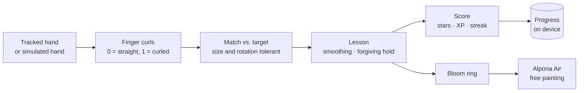

# SignBloom 🌸🤟

**Learn Bangla number signs with your hands — every sign you master blooms into a piece of alpona.**

A Snap **SPECS** Lens built for the *Learn AR with SPECS* hackathon.

[](https://github.com/shahriarsharif406/signbloom-specs/actions/workflows/ci.yml)


SignBloom turns learning sign language into making art. A target hand shape is shown as five finger gauges. You copy it with your own hand, hold it, and the sign "takes": a ring of petals blooms in front of you, interlocking with the rings from earlier signs. Finish the set and you unlock **Alpona Air** — pinch and draw in mid-air, and every stroke is mirrored into a symmetric alpona.

*Alpona* (আল্পনা) is the traditional Bengali floor art drawn for celebrations. Sign language is a language most hearing people never get to learn. SignBloom connects the two: practising becomes decorating.

## Features

| | |
|---|---|
| 🤟 **Learn mode** | 7 starter signs (শূন্য · এক · দুই · তিন · চার · পাঁচ · ভালো) with live finger gauges and a coach that names the finger to fix |
| 🧠 **Quiz mode** | Same signs, shuffled, hints hidden — show the sign from memory |
| ⭐ **Stars, XP & streaks** | 1–3 stars per sign for accuracy *and* fluency; combo streaks; lifetime progress saved on device |
| 🌸 **Bloom** | Each learned sign adds an interlocking petal ring with a staggered "pop" animation, then the bloom gently breathes |
| 🎨 **Alpona Air** | Pinch-and-draw with 4/6/8/12-fold symmetry, 7 brush colours, undo and clear |
| 🌐 **Bangla + English** | Whole UI, coaching and finger names in both languages, switchable at runtime |
| ♿ **Accessible preset** | Slower hold, wider tolerance, heavier smoothing, forgiving star pacing — for limited dexterity or tremor |
| 🔊 **Sound cues** | Optional soft cues for learned / 3-star / complete / tap |
| 🎬 **Demo mode** | A scripted virtual hand runs the whole experience in the Lens Studio preview — no headset needed to record |
| 🔒 **Private by design** | No network, no accounts, no analytics. Progress never leaves the device |

## How it works



The experience is one state machine — **welcome → learn / quiz → summary → paint** — implemented in pure TypeScript with no engine dependencies, so it is fully unit-tested. Thin Lens Studio components only read the hand and render the result. See [`docs/ARCHITECTURE.md`](docs/ARCHITECTURE.md).

## Repository layout

| Path | What it is |
|---|---|
| `Assets/Scripts/core/` | Pure logic: hand math, signs, lesson, session, scoring, progress, strings, theme, paint, symmetry. **Unit-tested.** |
| `Assets/Scripts/lens/` | Lens Studio components: SIK hand input, simulated hand, bloom renderer, painter, audio, controller. |
| `tests/` | 46 tests: matching, symmetry, lesson flow, scoring, persistence, i18n parity, session lifecycle. |
| `types/` | Local Lens Studio type stubs so CI can type-check the Lens scripts. |
| `docs/` | Setup, architecture, accessibility, roadmap. |
| `devpost/` | Plan, submission text, video script, checklist. |

## Quick start

```bash
npm install
npm run check      # 46 unit tests + type-check of the Lens scripts
```

To run the Lens itself, follow [`docs/SETUP.md`](docs/SETUP.md) (about 30 minutes in Lens Studio). With **Demo Mode** on, press Preview and watch a full run.

## Honest limitations

- Matching uses **finger curl**, so it recognises static hand shapes that differ in which fingers are curled or extended. Motion-based signs, two-handed signs and facial grammar need sequence recognition — see the [roadmap](docs/ROADMAP.md).
- Number-sign variants differ by region and community. This starter set must be **reviewed by a Bangla Sign Language (BdSL) educator** before it is used for real teaching. Adding or changing a sign is one entry in `core/SignLibrary.ts`.
- The `core/` logic is covered by automated tests; the Lens Studio scene glue was type-checked against local stubs and must be run in Lens Studio to confirm.

## Built with

- Lens Studio · Spectacles Interaction Kit (hand tracking) · TypeScript
- AI-assisted development with Claude (code and documentation drafted with an AI coding assistant, as the hackathon rules permit)

## License

MIT — see [LICENSE](LICENSE).
